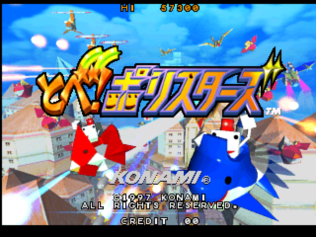
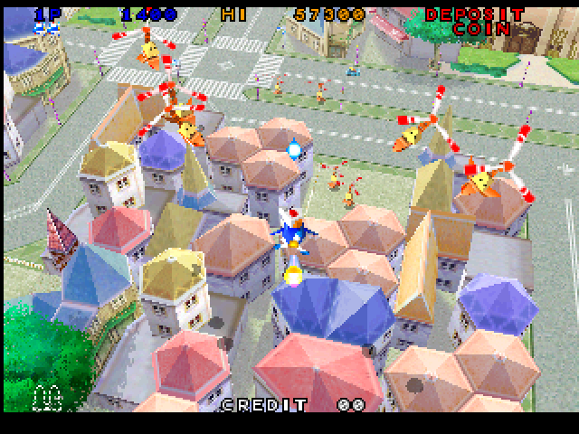

# Konami M2 for MiSTer

A MiSTer FPGA core for Konami's M2 arcade board (1997-1998), the 3DO M2 hardware of MAME's `konami/konamim2.cpp` driver. It runs
**Tobe! Polystars** (`polystar`), Konami's 3D shooter: two PowerPC 602s at 66.67 MHz, the BDA (memory controller, triangle engine,
video, audio DSP), the CDE (the CD drive's ATAPI bus) and Konami's I/O, with the game's program and data on a CD. Written from
MAME 0.289's driver and its `3dom2.cpp` / `3dom2_te.cpp` devices, with MAME as the reference; the platform layer and the way each block
is checked follow the owner's Gaelco 3D core.

<p align="center">
  
  
</p>

The title screen and stage 1, from MAME 0.289.

No ROMs or CD images are in this repository; you supply your own MAME set.

**Status.** Plays on a real MiSTer: the owner has run the attract mode for 60 minutes without a freeze and then played a game, with
its music and sound effects. **Heavy scenes run below the real board's speed**, and the game slows with them: about 30 pictures a
second measured at the start of stage 1, where the real board gives about 44.6. Built with Quartus 17.0: 41,273 of 41,910 ALMs (98 %),
461 of 553 M10K blocks, 69 of 112 DSPs, timing 0.264 ns short on the machine's clock and met on the HDMI clock.

| Game | Set | On this core |
|---|---|---|
| Tobe! Polystars (ver JAA, 1997) | `polystar` | plays, below full speed |
| Total Vice (ver EBA, 1997) | `totlvice` | not tried |
| Evil Night / Hell Night (1998) | `evilngt`, `hellngt` | not tried |
| Battle Tryst, Heat of Eleven '98 (1998) | `btltryst`, `heatof11` | not tried |

## Install

1. Unzip `KonamiM2_MiSTer_<date>.zip` (`tools/package.py` writes it to `dist/`) over the root of the SD card (`/media/fat/`): the core goes
   to `_Arcade/cores/`, `Tobe! Polystars (ver JAA).mra` to `_Arcade/`. By hand from the repository: `releases/KonamiM2_<date>.rbf` to
   `_Arcade/cores/`, the contents of `mra/` to `_Arcade/`.
2. Make the disc's images from your MAME set's `623jaa02.chd` (`polystar/623jaa02.chd`), with MAME's `chdman` and this repository's
   `tools/cdimage.py`:

   ```
   chdman extractcd -i polystar/623jaa02.chd -o polystar_full.cue -ob polystar_full.bin
   python3 tools/cdimage.py chdman polystar/623jaa02.chd polystar_cd.bin
   zip polystar_cd.zip polystar_cd.bin
   ```

   The first makes the whole disc, for the music (`polystar_full.bin`, 546 MB, with its `.cue`); the second its data track (`polystar_cd.bin`, 24 MB).
3. Put the files on the SD card:

   | File | Goes in |
   |---|---|
   | `polystar.zip` (your MAME 0.289 set) and `polystar_cd.zip` | `/media/fat/games/mame/` |
   | `polystar_full.bin` and `polystar_full.cue` | `/media/fat/games/polystar/` |

4. Start `Tobe! Polystars (ver JAA)` from the Arcade menu. Once, open the OSD and choose `polystar_full.bin` under *CD audio image*; Main
   remembers it and mounts it at each start. (The MRA also asks for it, but Main releases up to 20261010 don't act on that.)
   Without it the game runs without its music.

## Controls and OSD

A joystick and three buttons, Start, Coin and Service, set up in MiSTer's button mapping; the buttons have generic names for now.

| Option | Values |
|---|---|
| Aspect ratio | Original, Full Screen, two custom |
| Scale | Normal, V-Integer, HV-Integer, Narrower HV-Integer, HV-Integer+ |
| CD audio image | the disc's raw image |
| Service mode | Off, On |

## Known limits

- Below the real board's speed in heavy scenes.
- No CRT Adjust: the chip has no room for it now.
- The board's MPEG hardware isn't in the core.

## What is verified

- From power-on, in simulation (`sim/m2boot`), the machine loads the OS from the CD image and shows the same boot checks and title
  screen as MAME.
- The Triangle Engine's writes are the same as MAME's, byte for byte, on the lists dumped from the game (`sim/te`).
- The CPUs against MAME's instruction traces (`sim/ppcreplay`), the caches' coherence (`sim/coh`).
- On a real MiSTer, HDMI and a Sony CRT: the attract mode for 60 minutes, then a game.

Not checked: stages beyond those played, and a whole game to its end.

The plan and how the machine is built are in [docs/design.md](docs/design.md); what is known of the hardware is in
[docs/hardware.md](docs/hardware.md).

## Repository

| | |
|---|---|
| `KonamiM2.sv` | the MiSTer top level (`emu`) |
| `rtl/` | the machine |
| `sim/` | Verilator benches, run from WSL; `sim/run_all.sh` runs them all, one PASS / FAIL line each |
| `tools/` | MAME capture scripts (`tools/lua/`), the reports and image builders, the reference models (`tools/ref/`) |
| `mra/`, `releases/`, `dist/` | MRAs, the tested RBFs with their fitter / timing summaries, release notes and zips |
| `sys/` | the MiSTer framework |

The benches expect the owner's layout: this repository at `/mnt/c/repos/konamim2-mister/mister` and, next to it, `work/` with what is
never committed: MAME's sources (`work/mame/`), the romsets (`work/roms/`) and captures (`work/cap/`). A bench whose capture is missing is
skipped.

## Building

Quartus Prime Lite 17.0: open `KonamiM2.qpf` and compile; the RBF is `output_files/KonamiM2.rbf`.

## Capturing from MAME

`tools/lua/m2_capture.lua` records what Polystars asks of the triangle engine and the rest of the BDA: lists, triangles and
their render states, texture loads, the units' traffic, and (with `-debug`) per-frame CPU traces. Its settings are at the top
of the script; `tools/m2_report.py` summarises a capture.

```
mame polystar -window -nothrottle -autoboot_script tools/lua/m2_capture.lua
python3 tools/m2_report.py m2cap
```

`tools/lua/ppc_trace.lua` traces one CPU instruction by instruction (registers before each, every data access) from power-on
or from a given frame, for `sim/ppcreplay`; how to run it is at the top of the script.

## Credits

* **MAME**: the konamim2 driver and the 3DO M2 devices (`3dom2.cpp`, `3dom2_te.cpp`; Phil Bennett), the PowerPC core (Aaron Giles,
  R. Belmont; `tools/ref/`'s reference model follows it), the CD drive; the hardware knowledge and the reference for every comparison.
* The owner's Gaelco 3D core: the platform layer, the way each block is checked, the benches and the release packaging.
* The MiSTer framework (Sorgelig and contributors).

## Licence

GPL-3.0-or-later (`LICENSE`). The vendored modules keep their own licences (`modules/VENDOR.md`).
