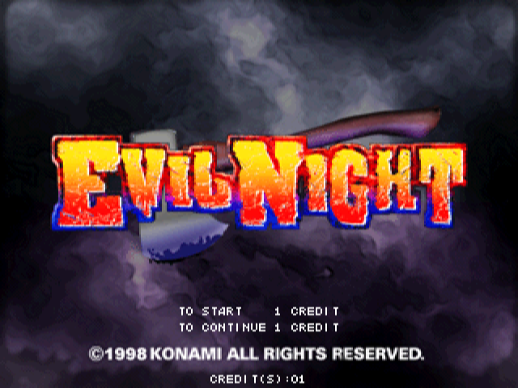
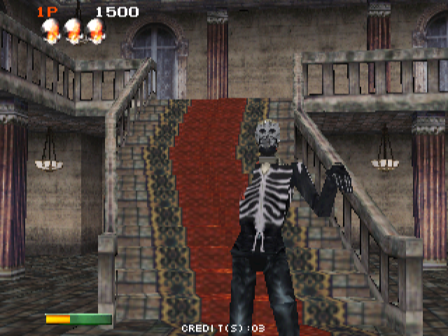
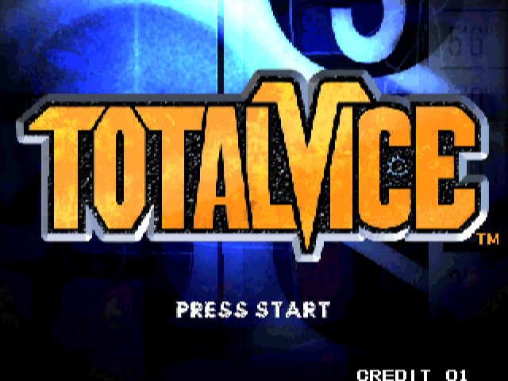
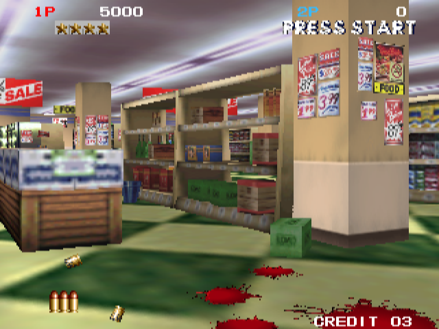

# Konami M2 for MiSTer

A MiSTer FPGA core for Konami's M2 arcade board (1997-1998), the 3DO M2 hardware of MAME's `konami/konamim2.cpp` driver. It runs
**Tobe! Polystars** (`polystar`), Konami's 3D shooter, and the two light-gun games **Evil Night** (`evilngt`) and **Total Vice**
(`totlvice`): two PowerPC 602s at 66.67 MHz, the BDA (memory controller, triangle engine, video, audio DSP), the CDE (the CD drive's
ATAPI bus) and Konami's I/O, with each game's program and data on a CD; for the gun games also their YMZ280B sample chip and the light
guns. Written from MAME 0.289's driver and its `3dom2.cpp` / `3dom2_te.cpp` devices, with MAME as the reference; the platform layer and
the way each block is checked follow the owner's Gaelco 3D core.

<p align="center">
  
  
</p>

Tobe! Polystars: the title screen and stage 1.

<p align="center">
  
  
</p>

Evil Night: the title screen and the mansion's hall.

<p align="center">
  
  
</p>

Total Vice: the title screen and the supermarket, with the service menu's VIOLENT MODE at BLOODY, as its MRA sets it. All six pictures
are from MAME 0.289.

No ROMs or CD images are in this repository; you supply your own MAME sets.

**Status.** All three games play on a real MiSTer, with their music and sound effects. The owner has played Tobe! Polystars through,
more than once, and has played Evil Night and Total Vice. **Polystars runs at full speed:** stage 3, timed against a video
of the real board, takes 154.8 s where the board takes 173.6 s (112 % of its speed; 110 % before the lava, 133 % in it, 106 % after).
Where the real board slows down, the core slows down less. Evil Night's and Total Vice's speed hasn't been timed against a real board.
Built with Quartus 17.0: 37,938 of 41,910 ALMs (91 %), timing met on every clock (+1.071 ns on the machine's, +0.566 ns on HDMI's).

| Game | Set | On this core |
|---|---|---|
| Tobe! Polystars (ver JAA, 1997) | `polystar` | plays, at full speed |
| Evil Night (ver UBA, 1998) | `evilngt` | plays: light guns, up to three players |
| Total Vice (ver EBA, 1997) | `totlvice` | plays: light guns, up to two players |
| Hell Night (ver EAA, 1998) | `hellngt` | planned |
| Total Vice (ver JAD, AAB, UAC, 1997) | `totlvicj`, `totlvica`, `totlvicu` | not working in MAME 0.289, not planned |
| Battle Tryst (ver JAC, 1998) | `btltryst` | not working in MAME 0.289, not planned |
| Heat of Eleven '98 (ver EAA, 1998) | `heatof11` | not working in MAME 0.289, not planned |

## Install

1. Unzip `KonamiM2_MiSTer_<date>.zip` (`tools/package.py` writes it to `dist/`) over the root of the SD card (`/media/fat/`): the core goes
   to `_Arcade/cores/`, the three MRAs to `_Arcade/`. By hand from the repository: `releases/KonamiM2_<date>.rbf` to `_Arcade/cores/`,
   `mra/Tobe! Polystars (ver JAA).mra`, `mra/Evil Night (ver UBA).mra` and `mra/Total Vice (ver EBA).mra` to `_Arcade/`.
2. Make each game's disc files from the CHD in your MAME 0.289 set. They aren't in a MAME set: `<set>_cd.zip` holds the disc's data
   track, which the core loads with the game, and `<set>_full.bin` the whole disc, from which it plays the music.

   | Game | The CHD | Makes |
   |---|---|---|
   | Tobe! Polystars | `polystar/623jaa02.chd` | `polystar_cd.zip` (24 MB in it), `polystar_full.bin` (546 MB), `polystar_full.cue` |
   | Evil Night | `evilngt/810uba02.chd` | `evilngt_cd.zip` (58 MB in it), `evilngt_full.bin` (515 MB), `evilngt_full.cue` |
   | Total Vice | `totlvice/639eba01.chd` | `totlvice_cd.zip` (42 MB in it), `totlvice_full.bin` (522 MB), `totlvice_full.cue` |

   The `.cue` is the image's cue sheet; the core doesn't need it. Make them in either of these ways:

   - **Any of the three, with this repository's `tools/m2disc.py`** (Python 3 and MAME's `chdman`, nothing else). From the folder you
     want the files in:

     ```
     python3 tools/m2disc.py polystar/623jaa02.chd
     python3 tools/m2disc.py evilngt/810uba02.chd
     python3 tools/m2disc.py totlvice/639eba01.chd
     ```

     `chdman` comes with MAME. If it isn't on the PATH, give it after the CHD; on Windows, for example,
     `py tools\m2disc.py totlvice\639eba01.chd C:\mame\chdman.exe`. The tool knows each disc by its tracks and checks its data, and
     says so if a CHD is none of the three or another version of the game: Total Vice's AAB, JAD and UAC discs have the same tracks,
     and the core runs only EBA's. Total Vice's CHD keeps its data track as 2048-byte sectors, and the core finds the music by 2352-byte
     ones, so the tool pads that track in `totlvice_full.bin`; it does the same for an older Polystars CHD kept that way. Polystars'
     music it also repairs (below).
   - **Any of the three, in a browser:** choose the CHD in the [Konami M2 CHD converter](https://konami-m2-chd-converter.fueledmyrrh2.chatgpt.site/)
     (for Polystars, keep *Repair gaps in Polystars music* ticked) and download the three files it makes. The conversion runs on your
     computer, and the CHD isn't uploaded. It needs a desktop browser (Chrome or Edge) and about 2 GB of free memory.

   **Polystars' music:** MAME marks `623jaa02.chd` as a bad dump: its music has 28 stretches of 0.35 s of silence, where the ripper's
   reads failed, 16 of them in the stage 7 boss's music. On the board they're short gaps in the music. Both ways above fill each from
   the same music elsewhere in its track (the music repeats). A `polystar_full.bin` made before, without the repair, is repaired in
   place by `python3 tools/cdfix.py polystar_full.bin`, which checks the file first and leaves alone one that isn't this image or is
   already repaired. The repair holds only positions; all the audio comes from your image. Evil Night's and Total Vice's CHDs have no
   such gaps.
3. Put the files on the SD card, for each game (`<set>` is `polystar`, `evilngt` or `totlvice`):

   | File | Goes in |
   |---|---|
   | `<set>.zip` (your MAME 0.289 set) and `<set>_cd.zip` | `/media/fat/games/mame/` |
   | `<set>_full.bin` and `<set>_full.cue` | `/media/fat/games/<set>/`, for example `/media/fat/games/totlvice/` |

4. Start the game from the Arcade menu. Once for each game, open the OSD and choose its `<set>_full.bin` under *CD audio image*; Main
   remembers it for that game and mounts it at each start. (The MRA also asks for it, but Main releases up to 20261010 don't act on
   that.) Without it the game runs without its music.

## Controls and OSD

**Tobe! Polystars:** a joystick, Shoot, Bomb, Start and Coin, for two players. The default pad layout: B shoots, A bombs, Start,
Select for a coin.

**Evil Night and Total Vice:** a light gun for each player (three in Evil Night, two in Total Vice), with Trigger, Reload, Start and
Coin. The default pad layout: B is the trigger, A reloads, Start, Select for a coin. Each player aims with any of these:

- **a light gun** that MiSTer sees as a pad's left analog stick (Sinden, GUN4IR): the gun points across the picture;
- **the d-pad**, which moves the aim while held;
- **the mouse**, for the player the OSD gives it: its left button is the trigger, the right reloads.

Reloading: in Evil Night, Players 1 and 3 aim up (their guns have a mercury switch) and Player 2 presses a button; in Total Vice,
each player shoots off the screen. Reload (Button 2) does each of these for you.

The service coin isn't on a button: Coin does the same.

| Option | Values |
|---|---|
| CD audio image | the disc's whole image, `<set>_full.bin` |
| Aspect ratio | Original, Full Screen, two custom |
| Scale | Normal, V-Integer, HV-Integer, Narrower HV-Integer, HV-Integer+ |
| P1 Stick, P2 Stick, P3 Stick (gun games; P3 in Evil Night) | Auto, Aim, D-pad: Aim points the gun where the stick points; D-pad moves it while the stick is pushed; Auto is Aim, but moves it as D-pad on a full push (an arcade stick on a pad encoder) |
| Mouse (gun games) | Player 1, Player 2, Player 3, Off |
| Crosshair (gun games) | Off, Player 1, Player 2, Player 3, P1+P2, All |
| Service mode | Off, On: the game's service menu |
| DIP Switches | Polystars and Total Vice: Sound Output (Stereo, Mono), Flip Screen (Off, On). Evil Night: Flip Screen |

**The service menus:** Evil Night's opens an item with the trigger. Total Vice's opens one only with Player 2's Start; while Service mode is On, Player 1's Button 3 (*Select (Service)*, X on the pad) does the same, so one controller is enough.

The service menu's settings (Free Play, the volume and the rest) are kept in the game's EEPROM, which MiSTer saves to `config/nvram/`
when the OSD is opened, and loads at the next start. The EEPROMs in Evil Night's and Total Vice's MAME sets hold the factory sound
volume, which is just as quiet in MAME (Evil Night 12 of 30, Total Vice 4 of 31), so their MRAs set it to 20 and 24. Total Vice's MRA
also sets GAME OPTIONS' VIOLENT MODE to BLOODY: the set has CLEAN, with no blood. A saved EEPROM in `config/nvram/` takes the MRA's place:
delete it to have the MRA's settings again. Evil Night's blood is GAME OPTIONS' BLOOD COLOR, which the set has at LIGHTNING.

## Notes

- **Speed:** in Polystars, where the real board slows down, the core slows down less (above). Evil Night and Total Vice haven't been
  timed against a real board.
- **Games:** Hell Night (ver EAA), Evil Night's other version, is planned: its picture and its guns' range differ from Evil Night's.
  Total Vice's JAD, AAB and UAC sets, Battle Tryst and Heat of Eleven '98 are marked not working in MAME 0.289, so the core can't be
  checked against it for them.
- **MPEG:** the 3DO M2's MPEG video decoder isn't in the core. No Konami M2 game is known to need it: MAME has only an empty stand-in
  for it and runs Polystars, Total Vice and Evil Night without one.
- **CRT Adjust:** not yet.

## What is verified

- From power-on, in simulation (`sim/m2boot`), the machine loads the OS from the CD image and shows the same boot checks and title
  screen as MAME.
- The Triangle Engine's writes are the same as MAME's, byte for byte, on the lists dumped from the game (`sim/te`).
- The CPUs against MAME's instruction traces (`sim/ppcreplay`) and against a reference model with random programs and interrupts
  (`sim/ppccore`), the caches' coherence (`sim/coh`).
- The YMZ280B against a port of MAME's device on Evil Night's sample ROM, sample for sample, on random voices and on the game's own
  writes (`sim/ymz`). The audio DSP against MAME's interpreter (`sim/dspp`); on MAME's dumps of each game's DSP program, each sample's
  work fits in the 1512 clocks it has (Total Vice's, the longest, takes at most 1319).
- `tools/m2disc.py`'s files, for all three games, are byte for byte the ones played on the board, and so are the browser
  converter's for Evil Night and Total Vice.
- On a real MiSTer, HDMI and a Sony CRT: Polystars' attract mode for 60 minutes; the whole game played through, with the repaired
  disc image without a gap in the music. Evil Night and Total Vice played, with their music and sound effects.

The plan and how the machine is built are in [docs/design.md](docs/design.md); what is known of the hardware is in
[docs/hardware.md](docs/hardware.md).

## Repository

| | |
|---|---|
| `KonamiM2.sv` | the MiSTer top level (`emu`) |
| `rtl/` | the machine |
| `sim/` | Verilator benches, run from WSL; `sim/run_all.sh` runs them all, one PASS / FAIL line each |
| `tools/` | the disc files' maker (`m2disc.py`, with `cdimage.py` and `cdfix.py`), MAME capture scripts (`tools/lua/`), the reports, the reference models (`tools/ref/`) |
| `mra/`, `releases/`, `dist/` | MRAs, the tested RBFs with their fitter / timing summaries, release notes and zips |
| `sys/` | the MiSTer framework |

The benches expect the owner's layout: this repository at `/mnt/c/repos/konamim2-mister/mister` and, next to it, `work/` with what is
never committed: MAME's sources (`work/mame/`), the romsets (`work/roms/`) and captures (`work/cap/`). A bench whose capture is missing is
skipped.

## Building

Quartus Prime Lite 17.0: open `KonamiM2.qpf` and compile; the RBF is `output_files/KonamiM2.rbf`.

## Capturing from MAME

`tools/lua/m2_capture.lua` records what Polystars asks of the triangle engine and the rest of the BDA: lists, triangles and
their render states, texture loads, the units' traffic, and (with `-debug`) per-frame CPU traces. Its settings are at the top
of the script; `tools/m2_report.py` summarises a capture.

```
mame polystar -window -nothrottle -autoboot_script tools/lua/m2_capture.lua
python3 tools/m2_report.py m2cap
```

`tools/lua/ppc_trace.lua` traces one CPU instruction by instruction (registers before each, every data access) from power-on
or from a given frame, for `sim/ppcreplay`; how to run it is at the top of the script.

## Credits

* **MAME**: the konamim2 driver and the 3DO M2 devices (`3dom2.cpp`, `3dom2_te.cpp`; Phil Bennett), the PowerPC core (Aaron Giles,
  R. Belmont; `tools/ref/`'s reference model follows it), the CD drive, the YMZ280B (`ymz280b.cpp`; Aaron Giles); the hardware
  knowledge and the reference for every comparison.
* The owner's Slap Shot core: the light guns (`rtl/m2_guns.sv`, after the owner's Seta 2 core and ppriest's `gx_guns.sv`).
* tallendorf: the single-precision float units and the FP-unavailable exception, triangle engine and DSP fixes, Heat of Eleven's
  build, `tools/cdimage.py`'s older CHDs.
* The owner's Gaelco 3D core: the platform layer, the way each block is checked, the benches and the release packaging.
* The MiSTer framework (Sorgelig and contributors).

## Licence

GPL-3.0-or-later (`LICENSE`). The vendored modules keep their own licences (`modules/VENDOR.md`).
