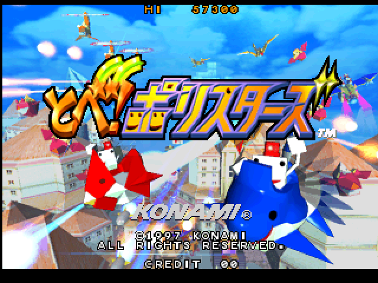
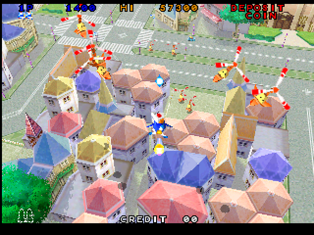
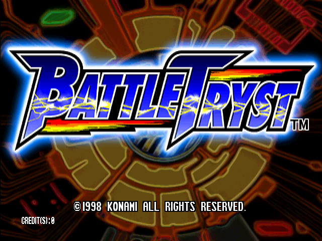
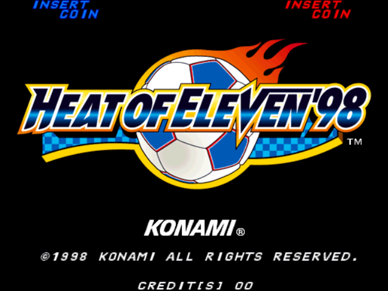

# Konami M2 for MiSTer

A MiSTer FPGA core for Konami's M2 arcade board (1997-1998), the 3DO M2 hardware of MAME's `konami/konamim2.cpp` driver. It runs
**Tobe! Polystars** (`polystar`), Konami's 3D shooter, the light-gun games **Evil Night** (`evilngt`), its European version **Hell
Night** (`hellngt`) and **Total Vice** (`totlvice`), the fighting game **Battle Tryst** (`btltryst`) and the football game **Heat of
Eleven '98** (`heatof11`): two PowerPC 602s at 66.67 MHz, the BDA (memory controller, triangle engine, video, audio DSP), the CDE (the
CD drive's ATAPI bus) and Konami's I/O, with each game's program and data on a CD; for the gun games also their YMZ280B sample chip and
the light guns. Hell Night, Battle Tryst and Heat of Eleven each have their own build, with the Z buffer in the SDRAM board's memory.
Written from MAME 0.289's driver and its `3dom2.cpp` / `3dom2_te.cpp` devices, with MAME as the reference; the platform layer and the
way each block is checked follow the owner's Gaelco 3D core, and the SDRAM builds' Z buffer is based on it.

<p align="center">
  <b>Tobe! Polystars</b><br>
  
  
</p>

<p align="center">
  <b>Evil Night</b><br>
  
  
</p>

<p align="center">
  <b>Total Vice</b><br>
  
  
</p>

<p align="center">
  <b>Hell Night</b><br>
  
  
</p>

<p align="center">
  <b>Battle Tryst</b><br>
  
  
</p>

<p align="center">
  <b>Heat of Eleven '98</b><br>
  
  
</p>

Battle Tryst's pictures are screenshots from a MiSTer; the others are from MAME 0.289.

No ROMs or CD images are in this repository; you supply your own MAME sets.

**Status.** All six games are supported, tested and working on a real MiSTer, with their music and sound effects: every game of
MAME's Konami M2 driver, Total Vice in its EBA version. The owner has played Tobe! Polystars through, more than once, and has played
Evil Night, Total Vice, Hell Night, Battle Tryst and Heat of Eleven '98; tallendorf has played the last three too, and left Battle
Tryst's and Hell Night's attract running for hours without a freeze.
**Polystars runs at full speed:** stage 3, timed against a video of the real board, takes 154.8 s where the board takes 173.6 s (112 %
of its speed; 110 % before the lava, 133 % in it, 106 % after). Where the real board slows down, the core slows down less. The other
games' speed hasn't been timed against a real board; Hell Night's continue screen and Battle Tryst's character select are known to run
slow (see Notes).
Built with Quartus 17.0, each core's timing met on every clock (the slack on the worst path):

| Core | ALMs (of 41,910) | Machine, 66.67 MHz | SDRAM, 133.33 MHz | HDMI |
|---|---|---|---|---|
| `KonamiM2` | 38,761 (92 %) | +1.152 ns | | +0.407 ns |
| `KonamiM2HellNight` | 41,439 (99 %) | +0.603 ns | +0.111 ns | +0.073 ns |
| `KonamiM2Tryst` | 41,396 (99 %) | +0.592 ns | +0.148 ns | +0.146 ns |
| `KonamiM2Heat` | 40,223 (96 %) | +0.881 ns | +0.591 ns | +0.356 ns |

| Game | Set | On this core |
|---|---|---|
| Tobe! Polystars (ver JAA, 1997) | `polystar` | plays, at full speed |
| Evil Night (ver UBA, 1998) | `evilngt` | plays: light guns, up to three players |
| Total Vice (ver EBA, 1997) | `totlvice` | plays: light guns, up to two players |
| Hell Night (ver EAA, 1998) | `hellngt` | plays: light guns, up to three players, on the arcade monitor's 512 x 384; its own build (`KonamiM2HellNight`), needs the SDRAM board |
| Battle Tryst (ver JAC, 1998) | `btltryst` | plays, close to full speed in a match; the MPEG intro is black; its own build (`KonamiM2Tryst`), needs the SDRAM board |
| Heat of Eleven '98 (ver EAA, 1998) | `heatof11` | plays; its own build (`KonamiM2Heat`), needs the SDRAM board |
| Total Vice (ver JAD, AAB, UAC, 1997) | `totlvicj`, `totlvica`, `totlvicu` | not supported: not working in MAME 0.289 |

## Install

1. Unzip `KonamiM2_MiSTer_<date>.zip` (`tools/package.py` writes it to `dist/`) over the root of the SD card (`/media/fat/`): the four
   cores go to `_Arcade/cores/`, the six MRAs to `_Arcade/`. Each MRA asks for its core by name:

   | Core | MRAs | Needs |
   |---|---|---|
   | `KonamiM2_<date>.rbf` | Tobe! Polystars, Evil Night, Total Vice | |
   | `KonamiM2HellNight_<date>.rbf` | Hell Night | the SDRAM board |
   | `KonamiM2Tryst_<date>.rbf` | Battle Tryst | the SDRAM board |
   | `KonamiM2Heat_<date>.rbf` | Heat of Eleven '98 | the SDRAM board |

   By hand from the repository: `releases/<core>_<date>.rbf` to `_Arcade/cores/`, `mra/*.mra` to `_Arcade/`. Hell Night, Battle Tryst
   and Heat of Eleven keep their Z buffer in the SDRAM board's memory (any size: it uses the first 32 MB).
2. Make each game's disc files from the CHD in your MAME 0.289 set. They aren't in a MAME set: `<set>_cd.zip` holds the disc's data
   track, which the core loads with the game, and `<set>_full.bin` the whole disc, from which it plays the music.

   | Game | The CHD | Makes |
   |---|---|---|
   | Tobe! Polystars | `polystar/623jaa02.chd` | `polystar_cd.zip` (24 MB in it), `polystar_full.bin` (546 MB), `polystar_full.cue` |
   | Evil Night | `evilngt/810uba02.chd` | `evilngt_cd.zip` (58 MB in it), `evilngt_full.bin` (515 MB), `evilngt_full.cue` |
   | Total Vice | `totlvice/639eba01.chd` | `totlvice_cd.zip` (42 MB in it), `totlvice_full.bin` (522 MB), `totlvice_full.cue` |
   | Hell Night | `hellngt/810eaa02.chd` | `hellngt_cd.zip` (58 MB in it), `hellngt_full.bin` (515 MB), `hellngt_full.cue` |
   | Battle Tryst | `btltryst/636jac02.chd` | `btltryst_cd.zip` (2 KB in it: the data sectors stream from `btltryst_full.bin`), `btltryst_full.bin` (423 MB), `btltryst_full.cue` |
   | Heat of Eleven '98 | `heatof11/703eaa02.chd` | `heatof11_cd.zip` (25 MB in it), `heatof11_full.bin` (315 MB), `heatof11_full.cue` |

   The `.cue` is the image's cue sheet; the core doesn't need it. Make them in either of these ways:

   - **Any of these, with this repository's `tools/m2disc.py`** (Python 3 and MAME's `chdman`, nothing else). From the folder you
     want the files in:

     ```
     python3 tools/m2disc.py polystar/623jaa02.chd
     python3 tools/m2disc.py evilngt/810uba02.chd
     python3 tools/m2disc.py totlvice/639eba01.chd
     python3 tools/m2disc.py hellngt/810eaa02.chd
     python3 tools/m2disc.py btltryst/636jac02.chd
     python3 tools/m2disc.py heatof11/703eaa02.chd
     ```

     `chdman` comes with MAME. If it isn't on the PATH, give it after the CHD; on Windows, for example,
     `py tools\m2disc.py totlvice\639eba01.chd C:\mame\chdman.exe`. The tool knows each disc by its tracks and checks its data, and
     says so if a CHD is none of these or another version of the game: Total Vice's AAB, JAD and UAC discs have the same tracks,
     and the core runs only EBA's. Total Vice's CHD keeps its data track as 2048-byte sectors, and the core finds the music by 2352-byte
     ones, so the tool pads that track in `totlvice_full.bin`; it does the same for an older Polystars CHD kept that way. Polystars'
     music it also repairs (below). Hell Night, Battle Tryst and Heat of Eleven are checked on their data sectors alone, as CHDs
     of their discs go round with the 2 s before the music kept in different ways; each is laid out as on the disc.
   - **Any of the six, in a browser:** choose the CHD in the [Konami M2 CHD converter](https://konami-m2-chd-converter.fueledmyrrh2.chatgpt.site/)
     (for Polystars, keep *Repair gaps in Polystars music* ticked) and download the three files it makes. The conversion runs on your
     computer, and the CHD isn't uploaded. It needs a desktop browser (Chrome or Edge) and about 2 GB of free memory.

   **Polystars' music:** MAME marks `623jaa02.chd` as a bad dump: its music has 28 stretches of 0.35 s of silence, where the ripper's
   reads failed, 16 of them in the stage 7 boss's music. On the board they're short gaps in the music. Both ways above fill each from
   the same music elsewhere in its track (the music repeats). A `polystar_full.bin` made before, without the repair, is repaired in
   place by `python3 tools/cdfix.py polystar_full.bin`, which checks the file first and leaves alone one that isn't this image or is
   already repaired. The repair holds only positions; all the audio comes from your image. Evil Night's and Total Vice's CHDs have no
   such gaps.
3. Put the files on the SD card, for each game (`<set>` is `polystar`, `evilngt`, `totlvice`, `hellngt`, `btltryst` or `heatof11`):

   | File | Goes in |
   |---|---|
   | `<set>.zip` (your MAME 0.289 set) and `<set>_cd.zip` | `/media/fat/games/mame/` |
   | `<set>_full.bin` and `<set>_full.cue` | `/media/fat/games/<set>/`, for example `/media/fat/games/totlvice/` |

4. Start the game from the Arcade menu. Once for each game, open the OSD and choose its `<set>_full.bin` under *CD audio image*; Main
   remembers it for that game and mounts it at each start. (The MRA also asks for it, but Main releases up to 20261010 don't act on
   that.) Without it the game runs without its music.

## Controls and OSD

**Tobe! Polystars:** a joystick, Shoot, Bomb, Start and Coin, for two players. The default pad layout: B shoots, A bombs, Start,
Select for a coin.

**Battle Tryst:** a joystick, Guard, Punch, Kick, Start and Coin, for two players. The default pad layout: A guards, B punches,
X kicks, Start, Select for a coin.

**Heat of Eleven '98:** a joystick, Pass/Tackle/Lifting, Long/Sliding/H.Lift and Shift (named as in the game's guides), Start and
Coin, for two players. The default pad layout: A, B and X are the three buttons in that order, Start, Select for a coin.

**Evil Night, Hell Night and Total Vice:** a light gun for each player (three in Evil Night and Hell Night, two in Total Vice), with
Trigger, Reload, Start and Coin. The default pad layout: B is the trigger, A reloads, Start, Select for a coin. Each player aims with
any of these:

- **a light gun** that MiSTer sees as a pad's left analog stick (Sinden, GUN4IR): the gun points across the picture;
- **the d-pad**, which moves the aim while held;
- **the mouse**, for the player the OSD gives it: its left button is the trigger, the right reloads.

Reloading: in Evil Night and Hell Night, Players 1 and 3 aim up (their guns have a mercury switch) and Player 2 presses a button; in Total Vice,
each player shoots off the screen. Reload (Button 2) does each of these for you.

The service coin isn't on a button: Coin does the same.

| Option | Values |
|---|---|
| CD audio image | the disc's whole image, `<set>_full.bin` |
| Aspect ratio | Original, Full Screen, two custom |
| Scale | Normal, V-Integer, HV-Integer, Narrower HV-Integer, HV-Integer+ |
| P1 Stick, P2 Stick, P3 Stick (gun games; P3 in Evil Night and Hell Night) | Auto, Aim, D-pad: Aim points the gun where the stick points; D-pad moves it while the stick is pushed; Auto is Aim, but moves it as D-pad on a full push (an arcade stick on a pad encoder) |
| Mouse (gun games) | Player 1, Player 2, Player 3, Off |
| Crosshair (gun games) | Off, Player 1, Player 2, Player 3, P1+P2, All |
| Service mode | Off, On: the game's service menu |
| Advanced: CPU caches (at reset) | 32 KB, 16 KB, 8 KB, 4 KB as the 602 (each side; Hell Night's build is fixed at 32 KB) |
| Advanced: SDRAM read timing (Battle Tryst, Heat of Eleven, Hell Night) | Normal, Late: the Z buffer's reads a clock later, for a module that answers slowly |
| Advanced: CPU 2 DEC interrupt | Off (the default), On: whether CPU 2 takes its decrementer exception. On is the 602's own behavior, but with it the M2 OS's scheduler can run on CPU 2 and corrupt its task queue (a freeze after hours); DEC counts either way |
| DIP Switches | Polystars and Total Vice: Sound Output (Stereo, Mono), Flip Screen (Off, On). Evil Night and Hell Night: Flip Screen. Battle Tryst and Heat of Eleven: none |

**The service menus:** Evil Night's opens an item with the trigger. Total Vice's opens one only with Player 2's Start; while Service mode is On, Player 1's Button 3 (*Select (Service)*, X on the pad) does the same, so one controller is enough.

The service menu's settings (Free Play, the volume and the rest) are kept in the game's EEPROM, which MiSTer saves to `config/nvram/`
when the OSD is opened, and loads at the next start. The EEPROMs in Evil Night's, Hell Night's and Total Vice's MAME sets hold the
factory sound volume, which is just as quiet in MAME (Evil Night and Hell Night 12 of 30, Total Vice 4 of 31), so their MRAs set it
to 20, 20 and 24. Total Vice's MRA
also sets GAME OPTIONS' VIOLENT MODE to BLOODY: the set has CLEAN, with no blood. A saved EEPROM in `config/nvram/` takes the MRA's place:
delete it to have the MRA's settings again. Evil Night's blood is GAME OPTIONS' BLOOD COLOR, which the set has at LIGHTNING.

## Notes

- **Speed:** in Polystars, where the real board slows down, the core slows down less (above). The other games haven't been timed
  against a real board. Two scenes are known to run slow: Hell Night's continue screen, whose 10 s take about 17, and Battle Tryst's
  character select, at about a third of its speed (its matches are close to full speed).
- **Hell Night** (ver EAA), Evil Night's European version, draws only in High Res, on the arcade monitor (512 x 384, about 24 kHz),
  where on this core the other games draw in Low Res (640 x 240, the TV's): its MRA's board byte asks for that raster, and its guns'
  range is MAME's hellngt's. A CRT for it needs to take 24 kHz. Its frame rate on the core is 58.6 Hz where MAME's is 59.5 Hz, so it
  runs about 1.6 % slow.
- **The SDRAM board's builds** (Hell Night, Battle Tryst, Heat of Eleven) keep the Z buffer there. On the bench, with the Z buffer in
  SDRAM, a few pixels of some pictures take another pixel's colour; not yet fixed.
- **In MAME:** MAME 0.289 marks Battle Tryst and Heat of Eleven '98 as preliminary. Its Heat of Eleven runs the attract mode; its
  Battle Tryst stops at the MPEG intro, which the core gets past. Total Vice's JAD, AAB and UAC sets are marked not working, and
  aren't supported.
- **MPEG:** the 3DO M2's MPEG video decoder isn't in the core. Battle Tryst's build has the MPEG unit's control, so the game gets
  past its MPEG intro, but the intro shows black. MAME has only an empty stand-in for the unit; no other game is known to use it.
- **CRT Adjust:** not yet.

## What is verified

- From power-on, in simulation (`sim/m2boot`), the machine loads the OS from the CD image and shows the same boot checks and title
  screen as MAME.
- The Triangle Engine's writes are the same as MAME's, byte for byte, on the lists dumped from the game (`sim/te`).
- The CPUs against MAME's instruction traces (`sim/ppcreplay`) and against a reference model with random programs and interrupts
  (`sim/ppccore`), the caches' coherence (`sim/coh`).
- The YMZ280B against a port of MAME's device on Evil Night's sample ROM, sample for sample, on random voices and on the game's own
  writes (`sim/ymz`). The audio DSP against MAME's interpreter (`sim/dspp`); on MAME's dumps of each game's DSP program, each sample's
  work fits in the 1512 clocks it has (Total Vice's, the longest, takes at most 1319).
- `tools/m2disc.py`'s files, for Polystars, Evil Night and Total Vice, are byte for byte the ones played on the board, and so are
  the browser converter's for Evil Night and Total Vice. For Hell Night, Battle Tryst and Heat of Eleven, MAME 0.289's own CHDs give
  the same data sectors as the Redump-based CHDs they were tested with, and the browser converter's files from them are byte for
  byte `tools/m2disc.py`'s.
- On a real MiSTer, HDMI and a Sony CRT: Polystars' attract mode for 60 minutes; the whole game played through, with the repaired
  disc image without a gap in the music. Evil Night and Total Vice played, with their music and sound effects. Hell Night, Battle
  Tryst and Heat of Eleven '98 played on their own cores, with the SDRAM board.
- By tallendorf, on a MiSTerPi, a MultiSystem 2 and a DE10-Nano with the SDRAM board: Hell Night and Heat of Eleven '98 played, a
  Battle Tryst match played; Hell Night's attract for 10 h without a freeze, and Battle Tryst's for 17.2 h and 16.6 h on a debug build
  that forces CPU 2's decrementer every half second, with the OSD's gate (*CPU 2 DEC interrupt* Off).

The plan and how the machine is built are in [docs/design.md](docs/design.md); what is known of the hardware is in
[docs/hardware.md](docs/hardware.md).

## Repository

| | |
|---|---|
| `KonamiM2.sv` | the MiSTer top level (`emu`) |
| `rtl/` | the machine |
| `sim/` | Verilator benches, run from WSL; `sim/run_all.sh` runs them all, one PASS / FAIL line each |
| `tools/` | the disc files' maker (`m2disc.py`, with `cdimage.py` and `cdfix.py`), MAME capture scripts (`tools/lua/`), the reports, the reference models (`tools/ref/`) |
| `mra/`, `releases/`, `dist/` | MRAs, the tested RBFs with their fitter / timing summaries, release notes and zips |
| `sys/` | the MiSTer framework |

The benches expect the owner's layout: this repository at `/mnt/c/repos/konamim2-mister/mister` and, next to it, `work/` with what is
never committed: MAME's sources (`work/mame/`), the romsets (`work/roms/`) and captures (`work/cap/`). A bench whose capture is missing is
skipped.

## Building

Quartus Prime Lite 17.0: open `KonamiM2.qpf` and compile; the RBF is `output_files/KonamiM2.rbf`.

Or from the command line, with `quartus_sh` on the PATH: `python3 tools/build.py [default|hellngt|tryst|heat]` compiles the
default build, Hell Night's, Battle Tryst's or Heat of Eleven's (the qsf's lines for it, its seed) in a copy under `build/`, and puts
the RBF in `releases/` as `KonamiM2_<date>.rbf`, `KonamiM2HellNight_<date>.rbf`, `KonamiM2Tryst_<date>.rbf` or
`KonamiM2Heat_<date>.rbf` (the names the MRAs ask for),
with its fitter and timing summaries, if it meets timing on every clock. `tools/package.py` puts the games' builds of the
release's date in its zip, with their MRAs.

## Capturing from MAME

`tools/lua/m2_capture.lua` records what Polystars asks of the triangle engine and the rest of the BDA: lists, triangles and
their render states, texture loads, the units' traffic, and (with `-debug`) per-frame CPU traces. Its settings are at the top
of the script; `tools/m2_report.py` summarises a capture.

```
mame polystar -window -nothrottle -autoboot_script tools/lua/m2_capture.lua
python3 tools/m2_report.py m2cap
```

`tools/lua/ppc_trace.lua` traces one CPU instruction by instruction (registers before each, every data access) from power-on
or from a given frame, for `sim/ppcreplay`; how to run it is at the top of the script.

## Credits

* **MAME**: the konamim2 driver and the 3DO M2 devices (`3dom2.cpp`, `3dom2_te.cpp`; Phil Bennett), the PowerPC core (Aaron Giles,
  R. Belmont; `tools/ref/`'s reference model follows it), the CD drive, the YMZ280B (`ymz280b.cpp`; Aaron Giles); the hardware
  knowledge and the reference for every comparison.
* The owner's Slap Shot core: the light guns (`rtl/m2_guns.sv`, after the owner's Seta 2 core and ppriest's `gx_guns.sv`).
* tallendorf: the single-precision float units and the FP-unavailable exception, triangle engine and DSP fixes and speed-ups,
  Hell Night's, Battle Tryst's and Heat of Eleven's builds (the Z buffer in the SDRAM, based on the owner's Gaelco 3D core; the
  arcade monitor's raster; the CD streaming; the MPEG unit's control; compressed texture loads), the fix for CPU 2's decrementer
  freeze, the CPU cache size option, `tools/build.py`, `tools/cdimage.py`'s older CHDs.
* The owner's Gaelco 3D core: the platform layer, the base of the Z buffer in the SDRAM (`rtl/m2_zmem.sv`), the way each block is
  checked, the benches and the release packaging.
* The MiSTer framework (Sorgelig and contributors).

## Licence

GPL-3.0-or-later (`LICENSE`). The vendored modules keep their own licences (`modules/VENDOR.md`).
